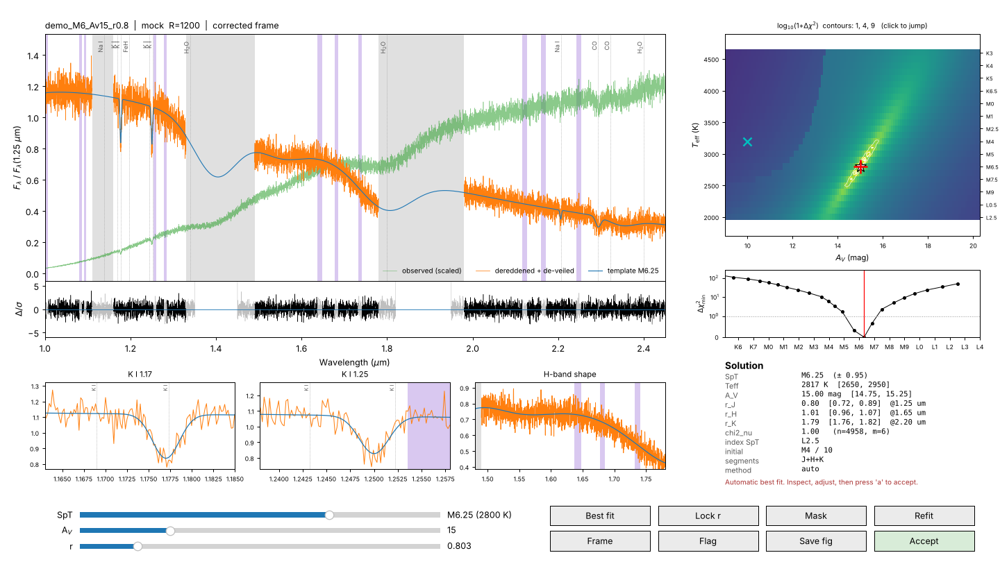

# YSOType

**Spectral type, extinction and veiling of young stellar objects from optical and near-infrared spectra.**

YSOType classifies young, embedded and accreting low-mass stars and brown dwarfs
(K, M and early-L types; Class 0/I, Flat and Class II sources) by fitting low-gravity
synthetic spectra (e.g. BT-Settl, log g = 3.5) while fitting the visual
extinction $A_V$ and the continuum veiling $r$ at the same time. Every
automatic solution is then checked by eye in an interactive inspector.

It was developed for the ODISEA spectroscopic survey of Ophiuchus (X-shooter,
GMOS, GNIRS and FIRE spectra), but works with any 1-D spectrum covering
0.55–2.5 µm.


<sub>The eye-check window (shown on the built-in toy example: `ysotype demo`).</sub>

## How it works

For every template $T(\lambda)$, convolved to the resolving power of the
observation, the observed spectrum is modelled as

$$
f_{\rm mod}(\lambda) = C\,\big[T(\lambda) + E_j\big]\,10^{-0.4\,A_V\,a(\lambda)},\qquad r_j = E_j / T(\lambda_{{\rm ref},j}),
$$

where $a(\lambda)=A_\lambda/A_V$ is the Fitzpatrick (1999) law ($R_V=5$ by default)
and $E_j$ is a flat excess continuum in segment $j$: a single veiling over
the whole spectrum, or one per band (optical, $J$, $H$, $K$).

* $T_{\rm eff}$ (template) and $A_V$ (0–60 mag in 0.1 mag steps) are explored
  on a grid.
* At every grid point, $C \ge 0$ and $E_j \ge 0$ enter the model linearly and are
  **solved exactly** by non-negative weighted least squares. The
  $\chi^2(T_{\rm eff}, A_V)$ surface is therefore exact, with no grid in $r$, and a full
  fit takes well under a second.
* Telluric bands, emission lines typical of YSOs (H I, He I, Ca II, [Fe II],
  H$_2$, ...; half-width $\max(3\lambda/R,\ \lambda\,300\,{\rm km\,s^{-1}}/c)$),
  low-S/N pixels and any user-defined regions are masked.
* Uncertainties come from the profile $\Delta\chi^2 \le 1$ after rescaling to
  $\chi^2_\nu = 1$ and correcting for the number of pixels per resolution
  element, since oversampled pixels are not independent.
* The best template $T_{\rm eff}$ is refined by a parabola through the $\chi^2$
  profile and converted to a spectral type with an editable SpT–$T_{\rm eff}$
  table, rounded to 0.25 subclass.
* Narrow-band spectral indices (TiO, VO, Na I, K I, FeH, H$_2$O, CO) are
  measured and give an independent, index-based first guess shown next to the
  fit.
* Optical and NIR results for the same object can be combined (`ysotype combine`).
  The SpT values are checked for agreement within ±1 subclass, $A_V$ is averaged,
  and the veiling is reported per band.

## Installation

```bash
git clone https://github.com/GITHUB_USER/YSOType.git
cd YSOType
pip install -e .
```

Requires Python ≥ 3.6 with numpy, scipy, matplotlib and astropy.

## Quick start

```bash
ysotype demo                       # toy example, no model atmospheres needed
```

### 1. Build a template grid (once)

Download BT-Settl spectra, e.g. from the
[SVO theoretical spectra server](http://svo2.cab.inta-csic.es/theory/newov2/)
(ASCII, λ in Å) or the original `.7` files. Then:

```bash
ysotype grid path/to/BT-Settl/ -o bt_settl_logg3.5.npz --logg 3.5 --teff-min 1200 --teff-max 5400
```

Teff and log g are read from the file names (`lte030-3.5-0.0a+0.0...`).

### 2. Fit a spectrum

```bash
ysotype fit J1627-2421_vis.fits --grid bt_settl_logg3.5.npz -R 5400 \
        --instrument XSHOOTER-VIS --initial-spt M5 --initial-av 10
```

The eye-check window opens on the automatic best fit. Press **a** to accept.
The solution is appended to `ysotype_results.csv` and a publication figure
(`<name>_ysotype.pdf`) is written. From IPython:

```python
%run -m ysotype fit J1627-2421_nir.fits --grid bt_settl_logg3.5.npz -R 1100 --veiling per-band
```

Useful options:

| option | meaning |
|---|---|
| `-R`, `--resolving-power` | instrument resolving power (required) |
| `--initial-spt`, `--initial-av` | starting values, drawn on the χ² map. They do **not** constrain the fit unless `--search-window DSPT DAV` is given |
| `--veiling single \| per-band \| none` | one veiling for the whole spectrum, one per optical/J/H/K band, or none |
| `--range WMIN WMAX` | fit range in µm |
| `--mask LO HI` | extra excluded region in µm (repeatable) |
| `--rv` | $R_V$ of the extinction law (default 5) |
| `--no-gui` | accept the automatic solution (batch mode) |

Wavelength units (µm, nm, Å) are detected automatically. Override with `--wave-unit`.

### 3. Combine optical and NIR

```bash
ysotype combine ysotype_results.csv -o ysotype_adopted.csv
```

## The eye-check window

| key / control | action |
|---|---|
| ← / → | hotter / cooler template |
| ↑ / ↓ (shift: ×10) | $A_V$ ± 0.5 mag (± 5 mag) |
| `[` / `]`, *r* slider | change the veiling (locks it); **l** frees it again |
| **b** | back to the automatic best fit |
| **d** | switch between the *corrected* frame (dereddened, de-veiled spectrum vs. template) and the *observed* frame (observed spectrum vs. reddened, veiled model) |
| **n** | overlay the templates one subclass hotter and cooler |
| **z** | next set of zoom panels (TiO, VO, Na I, K I, H-band shape, CO) |
| **m** | mask mode: drag to exclude a region, right-click to remove it; **u** undo |
| **f** | refit with the new masks |
| click on χ² map | jump to that ($T_{\rm eff}$, $A_V$) |
| **g** | cycle a quality flag (veiled, low-S/N, uncertain, check) |
| **s** | save the publication figure |
| **a** / Enter | accept and write the result |

## Python API

```python
from ysotype import read_spectrum, TemplateGrid, fit_spectrum
from ysotype.eyecheck import eyecheck
from ysotype.plotting import publication_figure

grid = TemplateGrid.load("bt_settl_logg3.5.npz")
spec = read_spectrum("J1627-2421_nir.fits", instrument="GNIRS")
res = fit_spectrum(spec, grid, 1100, veiling="per-band", initial_spt="M6")
print(res.summary())
res, accepted = eyecheck(res)
publication_figure(res, "J1627-2421.pdf")
```

## Customising

* `ysotype/data/spt_teff.csv`: the SpT–$T_{\rm eff}$ scale. **Replace the
  placeholder values with the scale you adopt** (e.g. Pecaut & Mamajek 2013;
  Herczeg & Hillenbrand 2014; Filippazzo et al. 2015) and remove the
  `STATUS: UNVERIFIED` line. You can also pass any table with `--scale`.
* `ysotype/data/indices.csv`: spectral-index definitions (band / continuum
  windows).
* Masks, segments and reference wavelengths: see `FitConfig` in `ysotype/fit.py`.

## Tests

```bash
pip install -e .[test]
pytest
```

The tests inject known $T_{\rm eff}$, $A_V$ and $r$ into mock spectra and check
that they are recovered. They also run the full command-line workflow
(grid → fit → combine) and drive the eye-check window headlessly.

## Citation

If you use YSOType, please cite the Zenodo record of the version you used (see
`CITATION.cff`) and the accompanying paper. Please also cite the template models
(BT-Settl: Allard et al. 2011) and the extinction law (Fitzpatrick 1999).

## License

MIT
